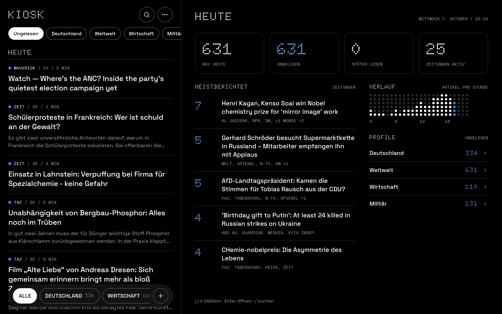

# Kiosk

Kiosk ist ein selbst gehosteter Nachrichten-Reader. Er sammelt die Artikel von rund 100 Zeitungen aus aller Welt
an einem Ort: Er holt ihre RSS-Feeds, lädt den Volltext der Artikel und zeigt alles in einer Web-App hinter
einem Login.



## Warum

Ich lese viele Zeitungen und wollte sie an einem Ort haben, statt zwischen Websites zu wechseln. Den Anstoß
gab spiegel.de. Zwischen den frei lesbaren Artikeln stehen dort SPIEGEL+-Artikel, an denen man beim Scrollen
ständig vorbeikommt. Kiosk zeigt deshalb nur frei zugängliche Artikel. Was die Verlage als bezahlpflichtig
markieren, blendet es aus. Umgangen wird keine Paywall.

## Was es macht

Der Katalog in `sources.yaml` enthält 100 Quellen auf Deutsch und Englisch, 31 davon sind beim ersten Start
eingeschaltet. Standardmäßig alle 15 Minuten holt der Server die Feeds, extrahiert den Artikeltext mit trafilatura und
speichert alles in SQLite mit Volltextsuche (FTS5). Artikel hinter einer Paywall werden an der Markierung der
Verlage erkannt und ausgeblendet. Nach 90 Tagen werden Artikel gelöscht, gemerkte bleiben.

Jedes Konto hat eigenen Lesestand, Profile (Zusammenstellungen von Zeitungen), Favoriten und Einstellungen.
Am Desktop zeigt die rechte Spalte Artikel anderer Zeitungen über dasselbe Ereignis. Am Handy beginnt die App
mit einer Titelseite.


Optional schreibt ein Sprachmodell über OpenRouter zweimal am Tag eine zusammenfassende Ausgabe aus allen
Artikeln. Sie erscheint als eigene Zeitung „Kiosk“ und kann per Mail an feste Empfänger gehen.

## Technik

Backend in Python 3.12 mit FastAPI 0.120, uvicorn, feedparser, trafilatura 2.2.0 und httpx (`app/`).
Datenbank ist eine SQLite-Datei mit WAL. Die Oberfläche ist eine PWA in reinem JavaScript ohne
Build-Schritt (`static/`). Betrieb in Docker hinter Caddy.

## Lokal starten

```bash
python3 -m venv .venv && .venv/bin/pip install -r requirements.txt
KIOSK_PASSWORD=test-passwort-lokal KIOSK_COOKIE_SECURE=false KIOSK_DOCS=1 .venv/bin/uvicorn app.main:app --reload --port 8100
```

Dann http://127.0.0.1:8100 öffnen und als `admin` mit dem Passwort aus `KIOSK_PASSWORD` anmelden.
Der erste Sammellauf startet sofort. Die API-Doku liegt nach dem Login unter `/docs`.

Alle Einstellungen stehen kommentiert in `.env.example`. Für die KI-Ausgabe braucht es `OPENROUTER_API_KEY`,
für den Mailversand die Variablen `KIOSK_MAIL_*`.

## Konten

Es gibt keine Registrierung und kein „Passwort vergessen“. Konten legt der Betreiber auf der Kommandozeile an:

```bash
.venv/bin/python -m app.users add anna --name "Anna"
.venv/bin/python -m app.users passwd anna
.venv/bin/python -m app.users list
```

## Tests

```bash
.venv/bin/pip install -r requirements-dev.txt
.venv/bin/python -m pytest
```

Die Tests für `static/js/format.js` und `static/js/route.js` laufen mit Node und werden ohne Node übersprungen.
Die Tests der Geschichten-Erkennung brauchen Testdaten mit rund 7.600 Überschriften und Anreißern der Verlage.
Die liegen aus urheberrechtlichen Gründen nicht im öffentlichen Repo, die Tests werden dann übersprungen.

## Abrufe

Kiosk ruft nur die Feeds aus `sources.yaml` ab und die Artikel, auf die sie verlinken. Weitere Seiten
durchsucht es nicht. Standardmäßig holt es jeden Feed alle 15 Minuten (`KIOSK_FETCH_INTERVAL`), mit
`If-None-Match` und `If-Modified-Since`, damit unveränderte Feeds nicht neu übertragen werden. Zwischen zwei
Abrufen beim selben Host liegen mindestens 0,4 Sekunden.

Kiosk meldet sich als `KioskReader/1.0 (private RSS reader)` und gibt sich nicht als Browser aus. Seiten, die
diesen Agent sperren, liefern keinen Volltext. `robots.txt` wertet Kiosk nicht aus.

## Rechtliches

Artikeltexte und Bilder gehören den Verlagen. Kiosk speichert Volltexte für den privaten Gebrauch. Eine
öffentliche Instanz oder einen Demo-Zugang gibt es deshalb nicht, die Bilder oben zeigen die Oberfläche
(Artikelbilder ausgeschaltet). Wer eine Instanz für mehrere Personen betreibt, gibt Volltexte an andere weiter.
Das ist urheberrechtlich heikel.

## Deploy

`bash deploy/deploy.sh` baut das Image auf dem Server, startet es und prüft den Login über Caddy.
Die Werte für den eigenen Server (SSH-Ziel, Domain, eigene IP-Adressen) stehen in `deploy/deploy.env`.
Die Datei liegt nicht im Repo, eine Vorlage ist `deploy/deploy.env.example`. Das Skript geht von einem
Server mit Docker, Caddy und Pfaden unter `/opt/kiosk` aus. Es arbeitet per SSH als root, weil es Caddy,
Cron und Besitzrechte einrichtet. Auf dem Server gehört der Code root. Der Container läuft als eigener
Benutzer mit schreibgeschütztem Dateisystem und darf nur in sein Datenverzeichnis schreiben. Details stehen in
`deploy/README.md`.

## Einschränkungen

- Es läuft genau ein uvicorn-Prozess. Sammler, Login-Bremse und Datenbankverbindung setzen das voraus.
- Paywall-Artikel fehlen ganz. Bei NZZ und South China Morning Post betrifft das die meisten Artikel.
- Einige Seiten sperren Server-Zugriffe (New York Times, Japan Times, The Hindu, ReliefWeb). Sie sind
  deshalb standardmäßig aus. Die ZEIT liefert den Feed, sperrt aber die Artikelseiten für `KioskReader`.
  Ohne Artikelseite erkennt Kiosk keine Z+-Artikel, deshalb ist auch die ZEIT standardmäßig aus.
- Bei 10 der 100 Quellen schließt die `robots.txt` den Feed oder die Artikelseiten für `KioskReader` aus
  (Stand Oktober 2026). Kiosk beachtet das bisher nicht.
- Bei manchen Verlagen bleiben Reste im Text, etwa „Lesen Sie auch“-Hinweise.
- Die Zuordnung zu Geschichten arbeitet nur auf Deutsch und Englisch. Sie verbindet lieber zu wenig als
  zu viel, dieselbe Meldung landet deshalb manchmal in zwei Geschichten.
- Bilder lädt der Browser direkt von den Verlagsseiten. Einen Bild-Proxy gibt es nicht.
- Für die Oberfläche gibt es keine Browser-Tests.
- Das voreingestellte Modell der KI-Ausgabe (`KIOSK_AI_MODEL`) ist ein Platzhalter. Ein Lauf mit
  Claude Sonnet kostet bis zu etwa 0,50 USD.

Die vollständige Beschreibung von API, Konfiguration, Abruf und KI-Ausgabe steht in `docs/REFERENZ.md`.

## Entstehung

Kiosk ist mit Claude Code entstanden, einem KI-Programmierwerkzeug von Anthropic. Den Großteil des Codes hat
das Modell geschrieben. Von mir kommen die Idee, die Anforderungen und die Entscheidungen, etwa welche
Zeitungen dabei sind, wie die Oberfläche aussieht und was die KI-Ausgabe schreiben soll. Die Änderungen liefen
vor dem Deploy durch die Testsuite und durch Reviews weiterer KI-Agenten. Die Commits tragen deshalb einen
`Co-Authored-By`-Vermerk von Claude.

## Lizenz

MIT, siehe `LICENSE`. Die Schriften in `static/fonts/` stehen unter der SIL Open Font License, die
Lizenztexte liegen daneben.
